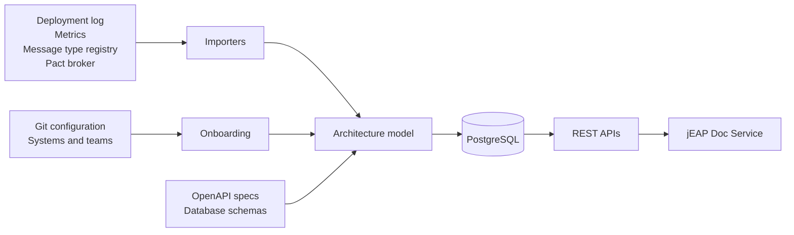

# jEAP Arch Repo Service

The jEAP Arch Repo Service maintains the **architecture inventory of a jEAP landscape**: which systems and
components exist, who owns them, which messages they exchange and which REST APIs they call. Systems and teams are
declared in Git configuration, including systems not yet deployed. Deployment logs, metrics, the message type registry
and the Pact broker supply the observed architecture; components push OpenAPI specs and database schemas.
The service reconciles these inputs into one model in PostgreSQL and exposes it over REST, including the
OAuth2-protected Docs API consumed by the jEAP Doc Service.

The Doc Service also accesses the Reaction Observer directly using OAuth2; Arch Repo does not call the Reaction Observer.

It is a **library**, not a deployable service: a jEAP microservice adds it as a Maven dependency and supplies the
configuration. See [Getting started](docs/getting-started.md).

The new architecture documentation is available from the jEAP Doc Service.

## Documentation

| Topic                                                      | Contents                                                                         |
| ---------------------------------------------------------- | -------------------------------------------------------------------------------- |
| [Concepts](docs/concepts.md)                               | Why the arch repo exists, what it covers, and the conventions it relies on       |
| [Getting started](docs/getting-started.md)                 | Embedding the library into a microservice instance and running it                |
| [Architecture](docs/architecture.md)                       | The modules, architecture model, onboarding decisions and scheduled model update |
| [Data model](docs/data-model.md)                           | The entities, their relationships and their tables                               |
| [Importers](docs/importers.md)                             | The importer plugin extension point and the importers that ship with the library |
| [API](docs/api.md)                                         | The REST API: the model, OpenAPI specs, database schemas and jobs                |
| [Docs API](docs/docs-api.md)                               | The segregated read API over the model, for the jEAP Doc Service                 |
| [Operations](docs/operations.md)                           | The scheduled jobs, monitoring, and the maintenance that stays manual            |
| [Configuration](docs/configuration.md)                     | All configuration properties, with their defaults                                |
| [Security](docs/security.md)                               | The two authentication mechanisms and the semantic roles                         |

## Changes

This library is versioned using [Semantic Versioning](http://semver.org/) and all changes are documented in
[CHANGELOG.md](./CHANGELOG.md) following the format defined in [Keep a Changelog](http://keepachangelog.com/).

## Note

This repository is part the open source distribution of jEAP. See [github.com/jeap-admin-ch/jeap](https://github.com/jeap-admin-ch/jeap)
for more information.

## License

This repository is Open Source Software licensed under the [Apache License 2.0](./LICENSE).
