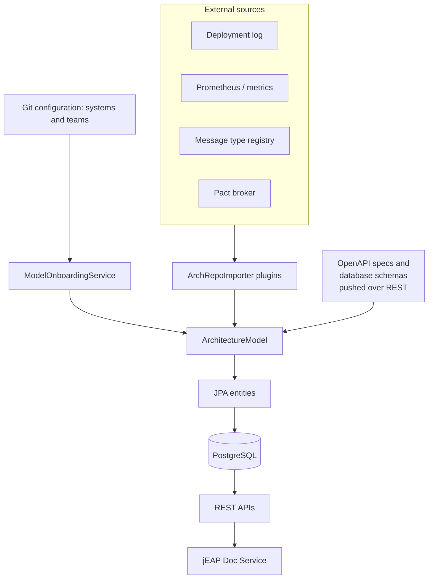

# Architecture

The arch repo service continuously assembles one **architecture model** of a jEAP landscape out of several
external sources, persists it in PostgreSQL, and exposes it over REST. The jEAP Doc Service consumes the
OAuth2-protected Docs API to generate architecture documentation.

The Doc Service reads architecture inventory through the OAuth2-protected Docs API and accesses the Reaction Observer
directly using OAuth2. The Arch Repo Service does not call the Reaction Observer.

## Modules

| Module                         | Contents                                                                                                                                                                      |
| ------------------------------ | ----------------------------------------------------------------------------------------------------------------------------------------------------------------------------- |
| `jeap-archrepo-metamodel`      | The model itself: `ArchitectureModel`, `System`, `SystemComponent`, `Event`, `Command`, the relation types, `RestApi`, `OpenApiSpec`, `SystemComponentDatabaseSchema`, `Team` |
| `jeap-archrepo-persistence`    | The Spring Data repositories, `ArchitectureModelRepository`, and the Flyway migrations under `db/migration/common`                                                            |
| `jeap-archrepo-importers`      | The `ArchRepoImporter` extension point - see [Importers](importers.md)                                                                                                        |
| `jeap-archrepo-importer-*`     | One module per source, each activating itself only when its configuration is present                                                                                          |
| `jeap-archrepo-dbschema-model` | The `DatabaseSchema` record - the format components push their schema in                                                                                                      |
| `jeap-archrepo-web`            | The `@SpringBootApplication`, the REST controllers, the security configuration and the scheduled jobs                                                                         |
| `jeap-archrepo-test`           | Test support and the Pact contract test base classes, for instances                                                                                                           |
| `jeap-archrepo-instance`       | A `pom`-packaged aggregator pulling `web` and `test` together for a deployment                                                                                                |

## The model: a transient aggregate over persistent entities

`ArchitectureModel` is a plain in-memory object - a builder, **no `@Entity`** - holding a list of `System` and a
list of `Team`. Its contents *are* JPA entities, though: `System` is the aggregate root, owning its components,
events, commands, relations, REST APIs, OpenAPI specs and database schemas with cascade. Events, commands and
relations are deleted by orphan removal. Components and their REST APIs, OpenAPI specs and database schemas are
not: they can move to another system (a rename, an alias moved), and JPA forbids reassigning an orphaned entity -
Hibernate deletes it or not depending on the load order. The model records their removal instead, and the
repository deletes them explicitly.

`ArchitectureModelRepository` bridges the two:

- `load()` assembles the transient model from `SystemRepository.findAll()` and `TeamRepository.findAll()`
- `save(model)` saves teams first, then systems and relation removals, then deletes removed artifacts and
  components, then removed systems and teams. Only new and detached aggregates are persisted or merged; loaded
  ones are still managed and are written by the flush, so new children are persisted as the model's own instances
  rather than merged copies. It flushes between destructive steps so cross-system REST references cannot block
  aggregate deletion

`UpdateService` saves the model once right after onboarding, before any importer runs, and again at the end, in
one transaction. Component names are unique across all systems, and Hibernate inserts before it deletes within a
flush, so a system deleted by onboarding must be gone before an importer may add a component of the same name
elsewhere. A component removed and reported again within the same update is revived instead of recreated, for the
same reason.

`ModelOnboardingService` reconciles systems and teams from `archrepo.model` before importers run. Configuration
owns their existence and metadata; external sources own components and the observed architecture below them.
The model tracks removals explicitly, so saving a partial model never implicitly deletes unrelated database rows.
New systems/teams expose their persistence lifecycle through Spring Data `Persistable` despite having assigned UUIDs.
Components cascade persistence to their parent so that a new cross-system REST provider can be reached before
its system's position in the save list without a missing parent row or a null foreign key.

An importer therefore never touches a repository. It receives the assembled model, changes it in memory, and the
caller saves it once at the end - which is what makes a run atomic.

### Provenance

Every element that an importer can create carries an `Importer` enum value naming the source it came from
(`GRAFANA`, `DEPLOYMENT_LOG`, `MESSAGE_TYPE_REGISTRY`, `PACT_BROKER`, `OPEN_API`, `REST_CONTROLLER`). That is what
lets a scheduled importer remove the elements that have disappeared from *its* source without touching anything
another source contributed, and it is what a generated page shows as "where this came from".

`SystemComponent` additionally carries `lastSeen`. A component that has not been seen for 14 days is
`isObsolete()`, and the metrics importers drop their own obsolete components at the end of their run.
[Operations](operations.md) has the full removal rules.

## Onboarding design decisions

Systems and teams are declared in Git; the database materializes that declaration together with the observed
architecture. The configuration contract and rollout procedure are in [Configuration](configuration.md).
The following choices keep that ownership boundary explicit:

| Decision | Rationale and trade-off |
| -------- | ----------------------- |
| One authoritative declaration, no additive mode | Keeping system/team creation endpoints or falling back to database-only teams would leave two sources of truth. Full declarations make export/apply/export converge; omitted metadata is cleared rather than silently retained. `DELETE /api/management/rest-api` remains because it has no configuration replacement. |
| Inert unless both lists are non-empty | A missing or partially mounted document must not wipe the model. Once both lists are present, omitted systems and teams are deleted. This deliberately rules out deleting the entire landscape through an empty document. |
| Reconcile in `UpdateService`, before importers | Importers need systems to exist before attaching components. A bootstrap step covers full and single-importer updates without changing importer priorities. It does not belong in `load()`, which also serves read-only API requests, or in a separate startup writer. |
| Bind once, apply inside the update transaction | Restarting binds one consistent document per instance; the next update applies it atomically with imported data. Errors visible in the document alone - unknown keys, blank names, duplicate names, conflicting aliases, undeclared teams - fail startup; conflicts with stored data fail the update and preserve the previous model. All landscape instances must deploy the same document. |
| Lists with explicit names, case-insensitive identity | Lists support free-form names without YAML scalar-key or Spring map-key escaping surprises. Case-insensitive maps detect ambiguity without relying on input order. Case-only edits preserve identity; real renames remain delete/create of the system because a stable rename key would require a separate model and migration design. Listing the old name as an alias of another system is the rename signal: components move there with their REST APIs, OpenAPI specs and database schemas. |
| Preserve component ownership when a system changes team | The default owner is inherited when a component is created, not continuously imposed on it. Rewriting existing owners could destroy deliberate per-component ownership. Reassignment is required only when the old team is deleted, to avoid dangling references. |
| Remove cross-system relations before aggregate deletion | Cascading a system alone cannot remove relations owned by other systems. Flushing relation removals before deleting systems, then teams, respects foreign keys without hiding model cleanup behind database cascades. Explicit removal lists also keep partial saves non-destructive. |
| Seal systems and teams after onboarding | The configuration is their only master. Once onboarding has applied it, the model rejects adding or removing a system or team, so an importer that tries fails the update loudly instead of creating data outside the declaration - also while onboarding is inactive. Importers keep full control of everything below systems. |
| Resolve systems on push, never create them implicitly | Otherwise a schema push could create a system outside the declaration and lose its artifact at the next authoritative update. Unknown systems therefore produce an ERROR and `422`; new components of known systems remain supported. |
| Public, deterministic export from the primary | Export bootstraps the Git document and supports meaningful drift diffs without changing the contracted Docs API. Replica lag could omit a recently written system and cause its deletion on rollout. Public access follows the existing model API's inventory access policy, deliberately extending exposure to team contacts and links. |

Deleting an aggregate is acceptable for importer-derived data, but pushed specs/schemas and component descriptions
are not automatically recoverable. The activation guard is not a substitute for backups and configuration review;
see the [deletion warning](configuration.md#bootstrap-and-gitops-rollout).

Removing the system/team creation endpoints and implicit push onboarding is a breaking change, released as 18.0.0.
The [API documentation](api.md#get-apimodelexport) describes the replacement export endpoint.

## The scheduled model update

It lives in `UpdateService` in `jeap-archrepo-web` and is guarded by ShedLock (`@SchedulerLock`), so only one
instance of a cluster runs it.

| Job             | Schedule                 | What it does                                                                                                             |
| --------------- | ------------------------ | ------------------------------------------------------------------------------------------------------------------------ |
| `updateModel()` | `archrepo.update-schedule` | Loads the model, applies onboarding, runs every registered importer in `getOrder()` sequence, cleans up stale REST elements, saves the model |

The update is `@Transactional` and saves once at the end, which makes a run atomic: an importer that throws rolls
the whole run back and leaves the previous model in place.

It can also be triggered on demand over `POST /api/jobs` - see [API](api.md).

Runs are tracked by a `SchedulerRunTracker`, which records the last successful run and publishes the
`archrepo_model_update_last_run_from` Micrometer gauge so that a stalled scheduler is visible in monitoring - see
[Operations](operations.md).

## Not all ingestion is scheduled

OpenAPI specs and database schemas are **pushed in synchronously** by the components themselves, over
`POST /api/openapi/{systemComponentName}` and `POST /api/dbschemas`. Those importers are plain Spring components,
not `ArchRepoImporter` plugins, because they run in the request rather than in the scheduled sweep.

## Related

- [Concepts](concepts.md) - why the arch repo exists and what it covers
- [Data model](data-model.md) - the entities behind the model, in detail
- [Importers](importers.md) - the extension point and the importers that ship with the library
- [API](api.md) - what the model is published over
- [Operations](operations.md) - running the jobs and monitoring them
- [Configuration](configuration.md) - the schedules and the source configuration
